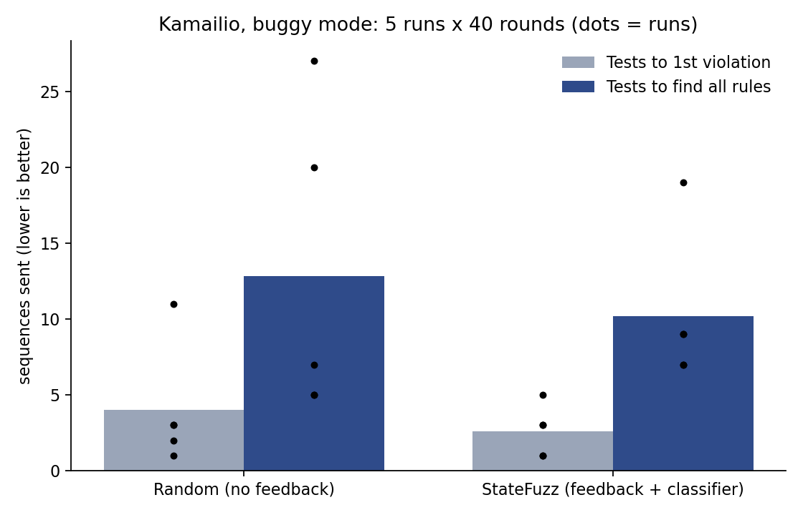

# StateFuzz — Learning, State-Aware Fuzzing for SIP Servers

Graduation project (B.Sc. Computer Science — Cybersecurity, Misr International University).

Most fuzzers only ask *"did the server crash?"*. StateFuzz asks *"did the server break a security rule?"*
and uses every broken rule as feedback to decide what to test next. The target is a real
[Kamailio](https://www.kamailio.org/) SIP server running in Docker.



## How it works

1. **Seeds** — normal SIP message sequences from public datasets (ProFuzzBench, SIPp, RFC 4475) plus built-in calls.
2. **Mutation** — a learner picks a mutation (wrong password, forged identity, BYE with no call, reordered messages…).
3. **Ranking** — a scikit-learn classifier scores candidate sequences by how likely they are to break a rule, before they are sent.
4. **Judging** — every reply is checked against declarative security rules in [`rules.json`](rules.json) (PASS / VIOLATION).
5. **Learning** — Thompson sampling rewards mutations that find new violations; confirmed violations are replayed to rule out noise.
6. **Logging** — every round is written to `datasets/execution_runs.csv`, the training data for the classifier.

## Components

| File | Role |
| --- | --- |
| `sip_messages.py` | Builds SIP requests |
| `fuzzer_client.py` | Sends sequences as user *alice* and answers auth challenges |
| `bob_uas.py` | Test phone that answers calls through Kamailio |
| `rule_checker.py` + `rules.json` | Security rules, the "judge" |
| `learning_fuzzer.py` | The fuzzing loop (random / Thompson / ranker strategies) |
| `ranker_model.py` | Classifier that ranks candidate sequences |
| `evaluate.py` | Compares strategies over many runs and plots the results |
| `dashboard.py` | Web dashboard to start, stop and watch the fuzzer |
| `switch_mode.py` | Switches Kamailio between secure and misconfigured mode |

## Run it

Requires Docker and Python 3.10+.

```bash
pip install -r requirements.txt
docker compose up -d              # Kamailio + test phone
python switch_mode.py buggy       # or: normal
python dashboard.py               # open http://127.0.0.1:8000
python evaluate.py                # compare random vs. StateFuzz
```

## Tech

Python · scikit-learn · Docker · Kamailio · SIP · Thompson sampling
